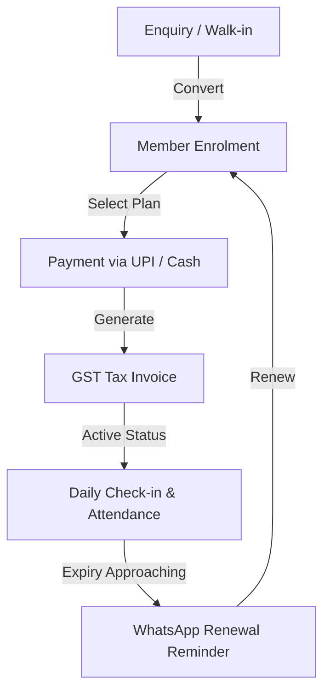
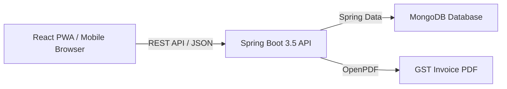

# GymKhata

> **Gym management made simple: bilingual, GST-ready, with zero per-member or per-message fees.**


---

## 1. Why Gym Owners Choose GymKhata

- **Transparent Flat Pricing:** ₹999/month flat fee. No per-member commissions, no per-message SMS/WhatsApp fees.
- **GST-Ready Invoices & UPI:** Instant generation of tax invoices or Bills of Supply with UPI QR code collection and UTR verification. *(Note: Default SAC is 999723 and GST rates are 18%/5% configurable; please confirm applicable rates and SAC with your Chartered Accountant).*
- **WhatsApp Renewal reminders:** Bilingual (Hindi + English) renewal reminders and alerts.
- **No App Install Required:** Mobile-first Progressive Web App (PWA) works instantly in any phone browser.
- **Optional QR Self Check-In:** Eliminate the need for a front desk receptionist with members scanning QR codes for check-ins.
- **Personal Training & Commission Tracking:** Track PT package sales and automate trainer commission calculations.
- **DPDP Data Export:** Full compliance features including member data export (JSON) and right-to-erasure anonymisation.

> **हिंदी सारांश:** जिम खाता स्वतंत्र जिम संचालकों के लिए आसान, जीएसटी-तैयार और बिना किसी अतिरिक्त शुल्क के जिम प्रबंधन सॉफ्टवेयर है। यह व्हाट्सएप रिमाइंडर, उपस्थिति, और भुगतान को सरल बनाता है।

---

## 2. Core Features & Workflow

### Feature Overview
| Feature | Description | Benefit |
| :--- | :--- | :--- |
| **Memberships** | Enrol, track, and renew memberships seamlessly | Automatic expiry tracking and status updates |
| **Billing & Invoices** | Financial year-aware gapless invoice numbering with GST | Compliant tax invoicing and receipts |
| **UPI Payments** | Direct UPI QR and 12-digit UTR verification | Zero payment gateway friction |
| **Check-ins** | QR code or manual check-in with daily limits | Accurate attendance tracking |
| **Leads & CRM** | Track inquiries and convert walk-ins to members | Boost conversion rates |

### The Member Lifecycle Loop


---

## 3. Live Demo & Logins

**Live Staging URL:** `[ADD: staging URL]`

Use these demo credentials (from `DEMO_DATA.md`):

| Role | Gym Name & Code | Phone | Password |
| :--- | :--- | :--- | :--- |
| **Super Admin** | Platform Level | `+919000000001` | `DemoAdmin@2026` |
| **Gym Owner** | `BAJRANG-LKO` (Bajrang Powerhouse) | `+919810010001` | `DemoOwner@2026` |
| **Gym Owner** | `IRONCORE-IND` (IronCore Strength Club) | `+919810010002` | `DemoOwner@2026` |
| **Gym Owner** | `SURYA-JPR` (Surya Akhada & Gym) | `+919810010003` | `DemoOwner@2026` |

---

## 4. For Investors

- **The Problem:** Independent gyms in tier-2/3 India struggle with fragmented manual registers, hidden per-member SaaS fees, and GST compliance complexity.
- **Target Customer:** Independent gyms and fitness centers across tier-2 and tier-3 Indian cities.
- **Business Model:** Predictable flat subscription model (₹999/month) with zero transactional rake-off or per-user scaling penalties.
- **Integration Status:**
  | Feature / Integration | Status |
  | :--- | :--- |
  | Direct UPI QR & UTR Verification | **Live** |
  | WhatsApp Click-to-Chat (`wa.me`) | **Live** |
  | WhatsApp Cloud API (Meta) | **Planned** |
  | Razorpay Payment Gateway | **Planned** |

- **Engineering Quality (as of last run):**
  - Backend Unit & Integration Tests: **113** tests passing.
  - Frontend Unit Tests (Vitest): **10** tests passing.
  - Real-Backend E2E Tests (Playwright): **14** tests passing.
- **Security Summary:** JWT-based stateless authentication, rotating refresh tokens, rate-limited login endpoints, role-based access control (Super Admin vs. single Gym Owner), and secure password hashing.
- **Traction:** `[ADD: traction]`
- **Roadmap:** Automated payment gateway integrations (Razorpay), Meta Cloud WhatsApp webhook automation, advanced multi-gym analytics.
- **Detailed Overview:** Refer to [`docs/INVESTOR_OVERVIEW.md`](docs/INVESTOR_OVERVIEW.md).

---

## 5. Quick Start & Tech Stack

### Quick Start
1. **Docker Compose:**
   ```bash
   docker compose up -d
   ```
2. **Local Windows Launchers:**
   - Double-click `start-all.bat` or run PowerShell scripts (`scripts/start-all.ps1`, `scripts/seed-demo.ps1`).

### Tech Stack
- **Backend:** Java 21, Spring Boot 3.5, Spring Security, Spring Data MongoDB, OpenPDF, ZXing.
- **Frontend:** React 19, Vite 8, TypeScript, Tailwind CSS 4, TanStack Query, Recharts.
- **Database:** MongoDB.
- **Testing:** JUnit, Mockito, Vitest, Playwright.



---

## 6. Known Limitations & Contact

- **Messaging & Payments:** Meta WhatsApp Cloud API and Razorpay are currently stubbed behind feature flags and marked planned; production defaults use WhatsApp Click-to-Chat links (`wa.me`) and Direct UPI UTR verification.
- **Build Info:** `build-info.properties` is generated automatically at build time.
- **Contact:** `[ADD: contact]`
