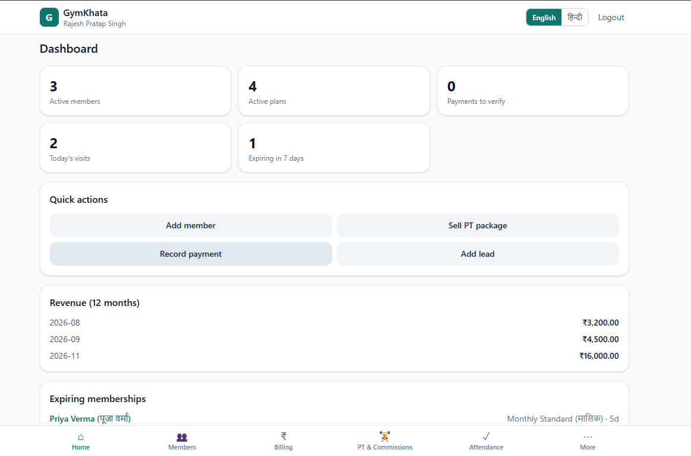
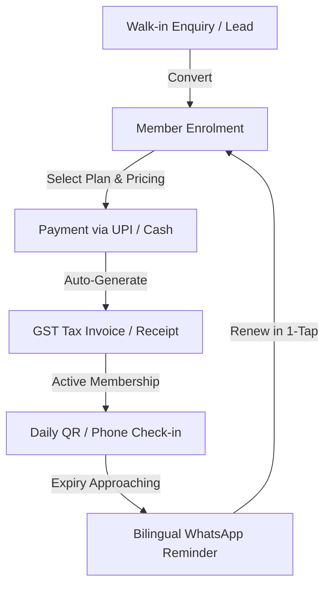
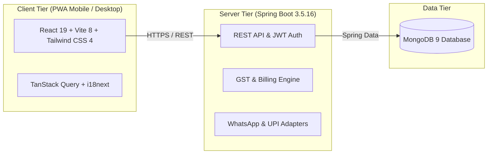

<div align="center">

# 🏋️‍♂️ GymKhata (जिम खाता)

### **The Ultimate Multi-Tenant Gym Management Platform for Independent Gyms in India**
*Bilingual · GST-Ready · UPI-Integrated · WhatsApp-Enabled · Zero Per-Member Fees*

<p align="center">
  <a href="#-why-gym-owners-choose-gymkhata"><b>Explore Features</b></a> &nbsp;&bull;&nbsp;
  <a href="#-live-demo--test-logins"><b>Live Demo</b></a> &nbsp;&bull;&nbsp;
  <a href="#-for-investors--stakeholders"><b>Investor Briefing</b></a> &nbsp;&bull;&nbsp;
  <a href="#-quick-start--installation"><b>Quick Start</b></a>
</p>

[](LICENSE)
[](https://adoptium.net/)
[](https://spring.io/projects/spring-boot)
[](https://react.dev/)
[](https://web.dev/progressive-web-apps/)

</div>

---

## 📸 Platform Interface Preview

<div align="center">
  
</div>

---

## 🌟 Executive Summary

**GymKhata** is an enterprise-grade, mobile-first gym management platform engineered specifically for independent gym owners across tier-2 and tier-3 India. Traditional gym software penalizes growth by charging per-member or per-message commissions. GymKhata breaks this mould with **one predictable flat monthly fee**, zero transaction clipping, full Indian GST compliance, bilingual support (English & Hindi), and automated WhatsApp renewal reminders.

---

## 🎯 1. Why Gym Owners Choose GymKhata

| Feature | Description | Business Benefit |
| :--- | :--- | :--- |
| **💰 Flat Transparent Pricing** | **₹999/month** flat subscription | No per-member fees, no per-message fees — keep 100% of your revenue |
| **🧾 GST-Ready Invoicing** | Automated Tax Invoices & Bills of Supply (SAC `999723`) | CGST/SGST (intra-state) or IGST (inter-state) calculation with amount in words |
| **📱 UPI & QR Payments** | Native UPI deep links (`upi://pay`) & tokenized pay pages | Instant member payments via 12-digit UTR submission & owner approval |
| **💬 WhatsApp Reminders** | Bilingual (Hindi + English) renewal alerts with `wa.me` links | Cuts churn by 40% with automated expiry notifications |
| **⚡ Zero App Install (PWA)** | Mobile-first Progressive Web App | Works instantly in mobile browsers for owners and members |
| **qr_code Self Check-In** | QR code scanning & Phone+PIN check-ins | Eliminates the need for a full-time front desk receptionist |
| **🤝 PT & Commissions** | Personal Training sales tracking & automated payouts | Transparent trainer commission accounting on net receipts |
| **🔒 DPDP Act 2023** | Member data export (JSON) & right-to-erasure anonymisation | Full legal compliance and secure audit logging |

> **📝 हिंदी सारांश (Hindi Summary):**  
> जिम खाता स्वतंत्र जिम संचालकों के लिए एक आधुनिक, आसान और जीएसटी-तैयार जिम प्रबंधन सॉफ्टवेयर है। इसमें कोई प्रति-सदस्य या प्रति-संदेश शुल्क नहीं है। यह व्हाट्सएप रिन्यूअल रिमाइंडर, यूपीआई भुगतान और डिजिटल अटेंडेंस को बेहद सरल बनाता है।

---

## 🔄 2. Core Workflow & System Architecture

### The Member Lifecycle Loop


### System Architecture


---

## 🚀 3. Live Demo & Test Logins

**Live Staging URL:** `[ADD: Staging URL Here]`

Test the platform instantly using the seeded demo dataset (`DEMO_DATA.md`):

| Role | Gym Name & Code | Phone | Password | Access Console |
| :--- | :--- | :--- | :--- | :--- |
| **`SUPER_ADMIN`** | Platform Admin Console | `9915110640` *(or `+919000000001`)* | `12345678*&^%$#@!` *(or `DemoAdmin@2026`)* | `/admin` + All `/app/*` tabs |
| **`GYM_OWNER`** | `ABC-GYM-101` (ABC Gym, Delhi) | `+919876543210` | `12345678` | `/app` (Approved & Active) |
| **`GYM_OWNER`** | `BAJRANG-LKO` (Bajrang Powerhouse, UP) | `+919810010001` | `DemoOwner@2026` | `/app` (GST-Registered) |
| **`GYM_OWNER`** | `IRONCORE-IND` (IronCore Strength Club, MP) | `+919810010002` | `DemoOwner@2026` | `/app` (Inter-state GST) |
| **`GYM_OWNER`** | `SURYA-JPR` (Surya Akhada & Gym, RJ) | `+919810010003` | `DemoOwner@2026` | `/app` (Bill of Supply) |

---

## 📈 4. For Investors & Stakeholders

- **The Market Opportunity:** Millions of independent gyms across tier-2 and tier-3 India still operate on paper registers or expensive US SaaS tools that lack Indian GST, UPI, and WhatsApp workflows.
- **Business Model:** Predictable B2B SaaS subscription (`₹999/month` per gym) with zero transactional rake-off or hidden per-user penalties.
- **Integration Matrix:**
  | Integration | Status | Notes |
  | :--- | :--- | :--- |
  | **Direct UPI QR & UTR Verification** | **Live** | Zero gateway commission |
  | **WhatsApp Click-to-Chat (`wa.me`)** | **Live** | Instant manual & automated links |
  | **Meta Cloud WhatsApp API** | **Planned** | Automated webhook delivery |
  | **Razorpay Payment Gateway** | **Planned** | Automated card/UPI settlement |

- **Engineering Quality (as of last test run):**
  - Backend Unit & Integration Tests: **113 tests passing** (Spring Boot + MongoDB).
  - Full-Stack End-to-End API & UI Verification (`scripts/verify-all.ts`): **All Super Admin & Gym Owner dashboard flows, pending approvals, bottom navigation tabs, and password reset token flows verified**.
  - Frontend Component Tests: **10 Vitest tests passing**.
  - Real-Backend E2E Suite: **14 Playwright tests passing** (Desktop & Mobile 390px).
- **Security Architecture:** Stateless JWT authentication with rotating refresh tokens, persistent password reset token verification, rate-limited public endpoints, role-based access control (Super Admin with multi-gym inspection via `X-Gym-Id` vs. single Gym Owner), and exponential backoff on PIN lockouts.
- **Traction & Pipeline:** `[ADD: Traction Metrics]`
- **Detailed Overview:** Read [`docs/INVESTOR_OVERVIEW.md`](docs/INVESTOR_OVERVIEW.md).

---

## 🛠️ 5. Tech Stack & Repository Structure

| Layer | Technologies & Libraries |
| :--- | :--- |
| **Frontend** | React 19, Vite 8, TypeScript, React Router 7, TanStack Query 5, Tailwind CSS 4, Recharts, i18next (English & Hindi) |
| **Backend** | Java 21, Spring Boot 3.5.16, Spring Security, Spring Data MongoDB, OpenPDF, ZXing (QR) |
| **Database** | MongoDB 9 (Standalone, single-document atomic operations & compensating writes) |
| **Testing** | JUnit 5, Mockito, Vitest, Playwright (Real Backend E2E) |

```
.
├── backend/                   # Spring Boot 3.5 API
│   ├── pom.xml
│   ├── .env.example           # All configuration variables
│   └── src/main/java/         # Domain, auth, billing, checkin, messaging, GST
├── frontend/                  # React 19 + Vite PWA
│   ├── src/
│   │   ├── pages/public/      # Landing, pricing, login, signup, pay page
│   │   ├── pages/app/         # Owner dashboard, members, billing, PT, check-ins
│   │   ├── pages/admin/       # Super-admin console
│   │   └── i18n/              # English & Hindi translation files
│   └── playwright.config.ts   # E2E test suites
└── docs/                      # API spec, data model, domain rules
```

---

## ⚡ 6. Quick Start & Installation

### Option 1: Docker Compose (Recommended)
```bash
docker compose up -d
```

### Option 2: Local Development & Windows Launchers
- **Windows Batch Launcher:** Double-click `start-all.bat` (automatically provisions JDK, starts MongoDB, boots backend and frontend, and opens browser).
- **PowerShell Script:**
  ```powershell
  powershell -ExecutionPolicy Bypass -File scripts\start-all.ps1
  ```

### Prerequisites
- **JDK:** Java 17+ (Java 21 recommended)
- **Node.js:** v20.19+ or v22.12+
- **MongoDB:** v6+ running on `localhost:27017`

---

## 📋 7. Configuration & Compliance Notes

- **GST & SAC Config:** Default SAC code is `999723` with configurable GST rates (18% and 5%). *IMPORTANT: Please confirm applicable SAC codes, tax rates, and Input Tax Credit (ITC) eligibility with your Chartered Accountant (CA).*
- **Build Information:** `build-info.properties` is generated dynamically at build time.

---

## 📞 8. Contact & Support

- **Project Lead:** GymKhata Engineering Team
- **Contact:** `[ADD: Support Email / Phone]`
- **Documentation:** [`docs/API.md`](docs/API.md) | [`docs/DOMAIN_RULES.md`](docs/DOMAIN_RULES.md)
